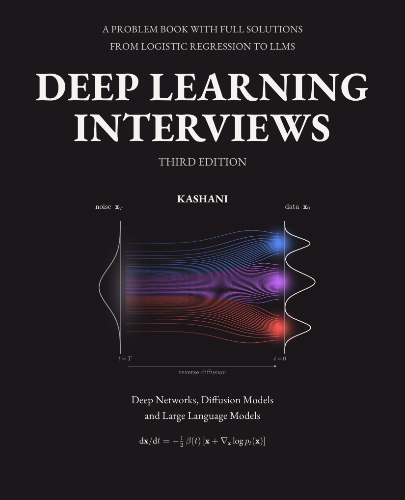
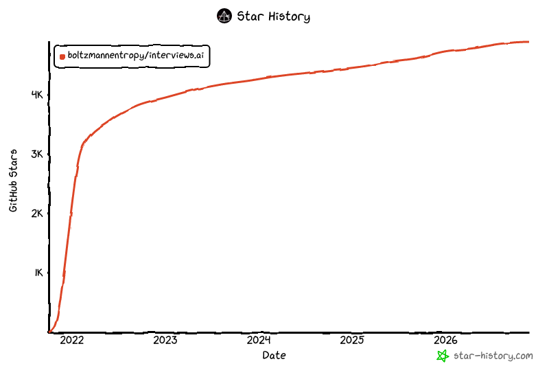
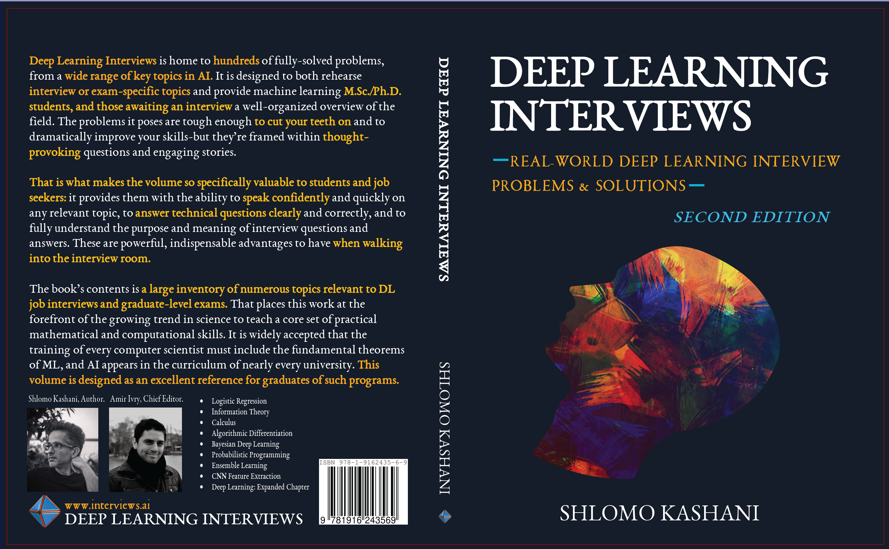
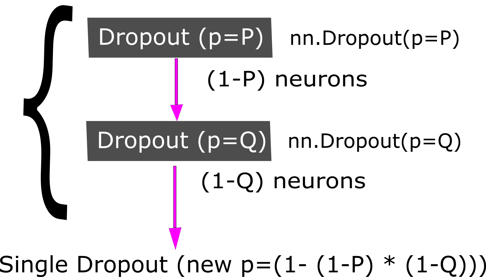

<div align="center">
  
  <br><br>
  <code>Third edition</code>&nbsp;&nbsp;in preparation · Second edition free on arXiv and in print
  <br><br>
  <h1>Deep Learning Interviews</h1>
  <p>Hundreds of fully solved job interview questions from a wide range of key topics in AI.<br>A problem book with full solutions, from logistic regression to large language models.</p>
  <br>
  <a href="https://interviews.ai"><strong>Website</strong></a>&nbsp;&nbsp;&nbsp;·&nbsp;&nbsp;&nbsp;<a href="https://arxiv.org/abs/2201.00650"><strong>Free PDF (second edition)</strong></a>&nbsp;&nbsp;&nbsp;·&nbsp;&nbsp;&nbsp;<a href="https://amazon.com/author/quantscientist"><strong>Buy on Amazon</strong></a>
  <br><br>
  Shlomo Kashani
  <br><br>
</div>

> **Mathematical Foundations** | **Deep Neural Networks** | **Diffusion Models** | **Large Language Models**

*Deep Learning Interviews* is a problem book for people who prepare for deep learning job interviews and graduate-level exams. Every problem comes with a worked solution. The **second edition** is free to read as a PDF and is sold in print. The **third edition** is in preparation. It keeps the deep learning core and adds diffusion models, large language models, and the engineering that trains and serves them.

## Editions

| Edition | Status | Contents | Where |
|---------|--------|----------|-------|
| **Third** | In preparation, not on sale yet | 582 solved problems, 21 chapters, 124 figures | [Contents below](#third-edition) |
| **Second** | Available | Hundreds of solved problems, 7 subject areas, almost 400 pages | [PDF on arXiv](https://arxiv.org/abs/2201.00650) · [Print on Amazon](https://amazon.com/author/quantscientist) |

## Stars

[](https://github.com/BoltzmannEntropy/interviews.ai/stargazers)

[](https://star-history.com/#BoltzmannEntropy/interviews.ai&Date)

---

## Third Edition

The third edition joins this book with *The Art and Science of Generative AI*. It keeps the deep learning core and adds diffusion models, large language models, and the engineering that trains and serves them.

Interviewers now ask about forward and reverse diffusion, the KV cache, and how a team aligns and serves a large model. You work each answer out from first principles, line by line.

| | |
|---|---|
| **Author** | Shlomo Kashani |
| **Problems** | 582, every one with a full solution derived in numbered equations |
| **Chapters** | 21, in four parts |
| **Figures** | 124, in one drawing style, printed in grayscale |
| **Labels** | Each problem carries a level and a role |

### Contents

| Part | Chapter | Problems |
| --- | --- | ---: |
| I. Mathematical Foundations | Logistic Regression | 26 |
| | Probabilistic Programming and Bayesian Deep Learning | 36 |
| | Information Theory | 32 |
| | Deep Learning Calculus | 36 |
| | Probability and Inference for Generative Models | 34 |
| II. Deep Neural Networks | Cross Validation, Convolution and Similarity | 29 |
| | Perceptrons and Activation Functions | 21 |
| | Metrics, Layers, Training and Loss | 40 |
| | Neural Network Ensembles | 22 |
| | Feature Extraction and Transfer Learning | 20 |
| | Architectures for Generative Models | 30 |
| III. Diffusion Models (new) | Generative Models and the Diffusion Idea | 9 |
| | Stochastic Processes and Stochastic Calculus | 43 |
| | Forward and Reverse Diffusion | 50 |
| | Denoising Diffusion in Practice | 39 |
| IV. Large Language Models (new) | Autoregressive Language Models | 22 |
| | Tokens, Data, Scaling and In-Context Learning | 21 |
| | Efficient Attention Families | 22 |
| | Training and Optimization at Scale | 15 |
| | Alignment and Preference Optimization | 19 |
| | Inference Systems: Caching, Batching and Serving | 16 |

### How a Problem Is Labelled

| Label | Values | Meaning |
|-------|--------|---------|
| **Level** | easy, standard, hard | An easy problem asks for one idea in a short calculation. A hard problem combines several ideas at the difficulty of a hard exam. A standard problem lies between the two. |
| **Role** | core, reinforcement, transfer, advanced | A core problem carries the main line of its chapter. A reinforcement problem drills a core idea. A transfer problem moves the idea into code or a new setting. An advanced problem goes beyond what a course would teach. |

If your interview is close, work the core problems first.

The third edition is not on sale yet, and its cover may change.

---

## Second Edition



### Download

**The PDF is available here:** https://arxiv.org/abs/2201.00650

This book is available for purchase through Amazon and other standard distribution channels. Please see the publisher's web page to order the book or to obtain further details on its publication. A manuscript of the book can be found below—it has been made available for personal use only and must not be sold.

* https://amazon.com/author/quantscientist

### About

The second edition of Deep Learning Interviews (The Amazon Softcover is printed in B&W) is home to hundreds of fully-solved problems, from a wide range of key topics in AI. It is designed to both rehearse interview or exam specific topics and provide machine learning M.Sc./Ph.D. students, and those awaiting an interview a well-organized overview of the field. The problems it poses are tough enough to cut your teeth on and to dramatically improve your skills-but they’re framed within thought-provoking questions and engaging stories.

That is what makes the volume so specifically valuable to students and job seekers: it provides them with the ability to speak confidently and quickly on any relevant topic, to answer technical questions clearly and correctly, and to fully understand the purpose and meaning of interview questions and answers. Those are powerful, indispensable advantages to have when walking into the interview room.

The book’s contents is a large inventory of numerous topics relevant to DL job interviews and graduate level exams. That places this work at the forefront of the growing trend in science to teach a core set of practical mathematical and computational skills. It is widely accepted that the training of every computer scientist must include the fundamental theorems of ML, and AI appears in the curriculum of nearly every university. This volume is designed as an excellent reference for graduates of such programs.

- The book spans almost 400 pages
- Hundreds of fully-solved problems
- Problems from numerous areas of deep learning
- Clear diagrams and illustrations
- A comprehensive index
- Step-by-step solutions to problems
- Not just the answers given, but the work shown
- Not just the work shown, but reasoning given where appropriate

This book was written for you: an aspiring data scientist with a quantitative background, facing down the gauntlet of the interview process in an increasingly competitive field. For most of you, the interview process is the most significant hurdle between you and a dream job. Even though you have the ability, the background, and the motivation to excel in your target position, you might need some guidance on how to get your foot in the door.
Your curiosity will pull you through the book’s problem sets, formulas, and instructions, and as you progress, you’ll deepen your understanding of deep learning. There are intricate connections between calculus, logistic regression, entropy, and deep learning theory; work through the book, and those connections will feel intuitive.

### Core Subject Areas (Volume I)

VOLUME-I of the book focuses on statistical perspectives and blends background fundamentals with core ideas and practical knowledge. There are dedicated chapters on:

- Information Theory
- Calculus & Algorithmic Differentiation
- Bayesian Deep Learning & Probabilistic Programming
- Logistic Regression
- Ensemble Learning
- Feature Extraction
- Deep Learning: expanded chapter (100+ pages)

These chapters appear alongside numerous in-depth treatments of topics in Deep Learning with code examples in PyTorch, Python and C++.



---

## A Personal Note

> "Keep learning, or risk becoming irrelevant."

In this first volume, I purposely present a coherent, cumulative, and content-specific core curriculum of the data science field, including topics
such as information theory, Bayesian statistics, algorithmic differentiation, logistic regression, perceptrons, and convolutional neural networks.
I hope you will find this book stimulating. 

It is my belief that you the postgraduate students and job-seekers for whom the book is primarily meant will benefit from
reading it; however, it is my hope that even the most experienced researchers will find it fascinating as well.

**I would like to solicit corrections, criticisms, and suggestions from students and other readers. Although I have tried to eliminate errors over the multi year process of writing and revising this text, a few undoubtedly remain. In particular, some typographical infelicities will no doubt find their way into the final version.** **I hope you will forgive them.**

---

## Errata (Second Edition)

<details>
<summary><b>Show the errata of the second edition</b> (may not be up to date; minor corrections are not included)</summary>

<br>

Thank you to all the readers who pointed out these issues. 
**Errata for the version** **03/12/2020** **printing and reflected in the online version:**

1.  Question number **PRB-267 -CH.PRB- 8.91** was removed due to lack of clarity 
2.  Question number **PRB-115 - CH.PRB- 5.16** was removed due to lack of clarity 

**Errata for the version** **05/12/2020** **printing and reflected in the online version:**

1. Page 230,  Question number **PRB-178** amend “startified scross validation“ TO “stratified cross validation.“
2. Page 231,  Question number **PRB-181** added a ” .“  after data-folds
3. Page 231,  Question number **PRB-191** amend “an” to “a”
4. Page 234,  Question number **PRB-192** “in” repeated twice 
5. Page 236,  Question number **PRB-194 amend** “approached” to “approaches“, “arr” to “arr001”
6. Page 247,  Question number **PRB-210 amend** “an” to “a”
7. Page 258,  Question number **PRB-227 amend**  “A confusion metrics” to “A confusion matrix” 
8. Page 271,  Question number **PRB-240 amend**  “MaxPool2D(4,4,)” to “MaxPool2D(4,4)”
9. Page 273,  Question number **PRB-243 amend**  “identity” to “identify”
10. Page 281,  Question number **PRB-254 amend**  “suggest” to “suggests”
11. Page 283,  Question number **PRB-256**  “happening” misspelled 
12. Page 286,  “L1, L2” amended to “Norms” 
13. Page 288,  Question number **SOL-184**  **amend** “the full” to “is the full”
14. Page 298,  Question number **SOL-208**  **amend** “ou1” to “out”
15. Page 319,  Question number **SOL-240**  **amend** “torch.Size([1, 32, 222, 222]).”  to “torch.size([1, 32, 222, 222]).“
16. Page 283,  Question number **PRB-256**  “happening” was misspelled 

**Errata for the version** **07/12/2020** **printing and reflected in the online version:**

1. Page 187,  Question number **PRB-140** two missing plots (6.3, 6.4) which did not render correctly on the print version 


6.3


6.4
**Errata for the version** **09/21/2020** **printing and reflected in the online version:**

1. Page 34,  Solution number **SOL-19** , 0.21886 should be 0.21305 and 0.21886 ± 1.95 × 0.21886  should be **0.21305** ± 1.95 × 0.21886 
2. Page 36-7,  Solution number **SOL-21** ,4.8792/0.0258 = **189.116** and not 57.3  and pi(33) = 0.01748 and not pi(33) = **0.211868**.
3. Page 49, **PRB-47**  “What is the probability that the expert is a **monkey**“ should be “What is the probability that the expert is a **human**” 

**Errata for the version** **09/22/2020** **printing and reflected in the online version:**

1. Page 73,  Solution number **SOL-56**  should read ”The Hessian is generated by **differentiating**” 
2. Page 57,  Problem number **PRB-65**  should read ”**two** neurons” 

**Errata for the version** **09/24/2020** **printing and reflected in the online version:**

1. Page 78,  Solution number **SOL-64** , the OnOffLayer is off only if at least 150 out of 200 neurons are off. Therefore, this may be represented as a Binomial distribution  and the probability for the layer to be off is :


</details>

---

## Authors

| | |
|---|---|
| **Author** | Shlomo Kashani · [LinkedIn](https://www.linkedin.com/in/quantscientist/) · [Google Scholar](https://scholar.google.com.mx/citations?user=bM0LGgcAAAAJ&hl) |

---

## Citation

### Third Edition

The third edition is in preparation.

```bibtex
@book{kashani2026deep,
      title={Deep Learning Interviews: Hundreds of Fully Solved Problems, from Logistic Regression to Diffusion Models and Large Language Models},
      author={Shlomo Kashani},
      edition={Third},
      year={2026},
      publisher={Interviews AI},
      address={Jerusalem, Israel},
      note={In preparation},
      url={https://www.interviews.ai}
}
```

**APA Format:**

Kashani, S. (2026). *Deep Learning Interviews: Hundreds of fully solved problems, from logistic regression to diffusion models and large language models* (3rd ed.) [Manuscript in preparation]. Interviews AI. https://www.interviews.ai

**IEEE Format:**

S. Kashani, *Deep Learning Interviews: Hundreds of Fully Solved Problems, from Logistic Regression to Diffusion Models and Large Language Models*, 3rd ed. Jerusalem, Israel: Interviews AI, 2026, in preparation. [Online]. Available: https://www.interviews.ai

### Second Edition

The citation below is for the second edition, the one on arXiv.

```bibtex
@misc{kashani2021deep,
      title={Deep Learning Interviews: Hundreds of fully solved job interview questions from a wide range of key topics in AI},
      author={Shlomo Kashani and Amir Ivry},
      year={2021},
      eprint={2201.00650},
      note = {ISBN 13: 978-1-9162435-4-5 },
      url = {https://www.interviews.ai},
      archivePrefix={arXiv},
      primaryClass={cs.LG}
}
```

**APA Format:**

Kashani, S., & Ivry, A. (2021). *Deep Learning Interviews: Hundreds of fully solved job interview questions from a wide range of key topics in AI* (2nd ed.). arXiv:2201.00650. https://www.interviews.ai

**IEEE Format:**

S. Kashani and A. Ivry, "Deep Learning Interviews: Hundreds of fully solved job interview questions from a wide range of key topics in AI," 2nd ed., arXiv:2201.00650, 2021. [Online]. Available: https://www.interviews.ai

---

## License

- Copyright © [Shlomo Kashani, author of the book "Deep Learning Interviews"](https://www.interviews.ai)

**SELLING OR COMMERCIAL USE IS STRICTLY PROHIBITED**.
The user rights of this e-resource are specified in a licence agreement below.
You may only use this e-resource for the purposes *private study*.
Any selling/reselling of its content is strictly prohibited.

---

## Disclaimers

- "PyTorch" is a trademark of Facebook.
